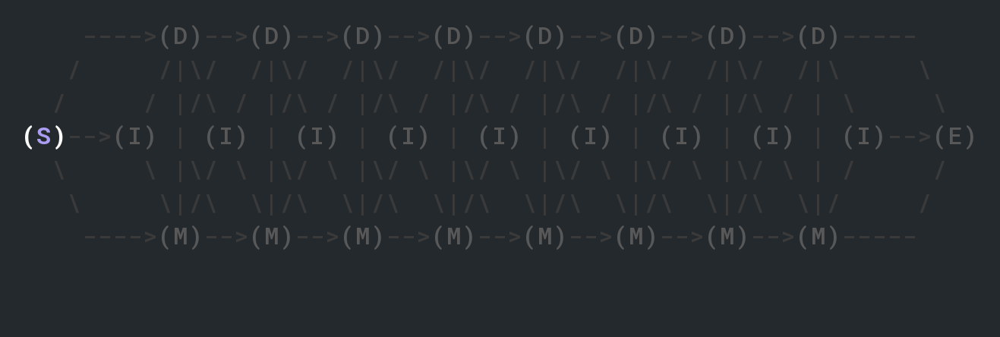
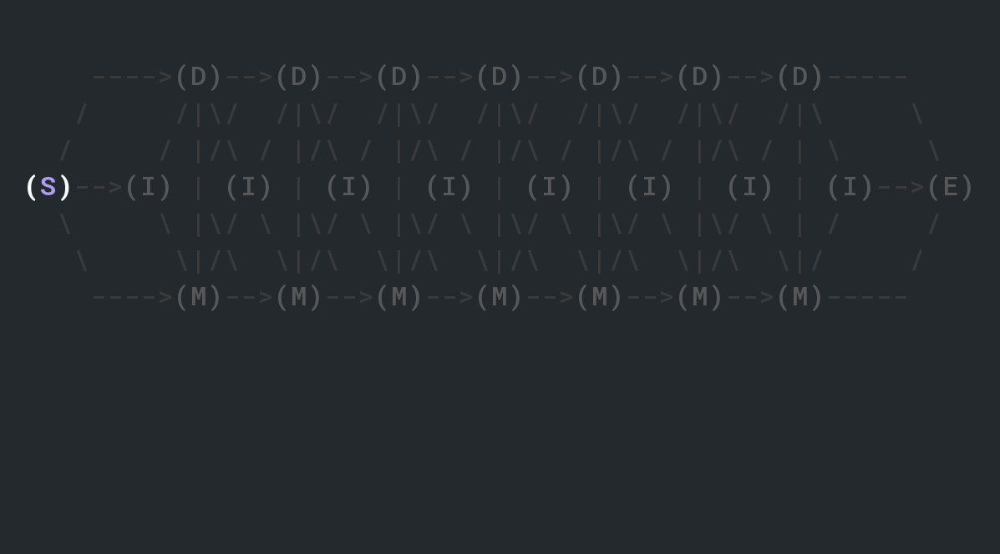

# anihmm

`anihmm` draws small HMM-style animations in a terminal. Use it as a loading
indicator, build a custom state path, or render individual frames with
[Rich](https://github.com/Textualize/rich).



## Install

```bash
pip install anihmm
```

Python 3.10 or newer is required.

## Use

Wrap the work you want to animate:

```python
from anihmm import ProcessingOptions, processing_animation

with processing_animation(ProcessingOptions.random()):
    run_your_work()
```

The animation runs in the background and stops when the block exits. When
output is redirected or captured, `anihmm` stays quiet automatically.

When the work finishes, you can replace the animation with a final frame and
print the results:



To show fixed text on a random path:

```python
with processing_animation(
    ProcessingOptions.random(emissions="SEARCHING", seed=7)
):
    run_your_work()
```

Async code uses the matching context manager:

```python
from anihmm import ProcessingOptions, async_processing_animation

async with async_processing_animation(ProcessingOptions.random()):
    await run_your_work()
```

Advance a predetermined path as individual units of work complete:

```python
from anihmm import progress_animation

with progress_animation(columns=3) as progress:
    for state, emission in (("M", "A"), ("D", None), ("M", "C")):
        run_one_step()
        progress.advance(state, emission=emission)
    progress.finish()
```


## Build a sequence

Use `HMMSequence` when a preset is not enough:

```python
from anihmm import HMMSequence, compile_steps

sequence = HMMSequence()
for symbol in "SEARCH":
    sequence.settle("M")
    sequence.emit(symbol)
sequence.finish()

frames = compile_steps(sequence.build())
```

## More examples

Generate an exact number of random emissions:


Keep fixed text while generating a different path on each loop:


Complete the unused columns of a bounded sequence with deletion states:


Preview every possible transition before settling on one:


The runnable versions are in
[`examples/`](https://github.com/leightonpayne/anihmm/tree/main/examples/), with explanations in
the [examples guide](https://leightonpayne.github.io/anihmm/usage/example/).

## Documentation

- [Quickstart](https://leightonpayne.github.io/anihmm/usage/quickstart/)
- [Examples](https://leightonpayne.github.io/anihmm/usage/example/)
- [Python API guide](https://leightonpayne.github.io/anihmm/usage/inputs/)
- [API reference](https://leightonpayne.github.io/anihmm/reference/)
