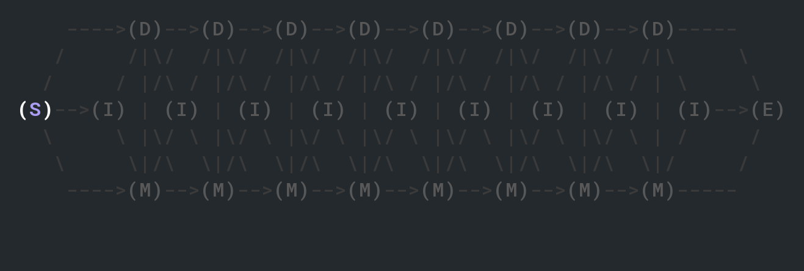

# anihmm

`anihmm` adds small HMM-style animations to terminal applications. Use it as
a loading indicator, to visualize search progress, or to demonstrate profile
HMM paths in the terminal.

 

- **[:lucide-arrow-right: Install](about/installation.md)**

    Get `anihmm` from PyPI and check that it works in your environment.

- **[:lucide-arrow-right: Quickstart](usage/quickstart.md)**

    Add a background animation around a block of Python code.

- **[:lucide-arrow-right: Examples](usage/example.md)**

    See the real terminal playback alongside the code that produces it.

- **[:lucide-arrow-right: Python API](usage/inputs.md)**

    Choose the right level of control for frames, playback, and rendering.

- **[:lucide-arrow-right: Custom sequences](usage/sequences.md)**

    Define paths, emissions, and state transitions for your own animation.

