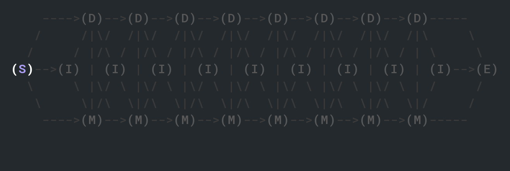
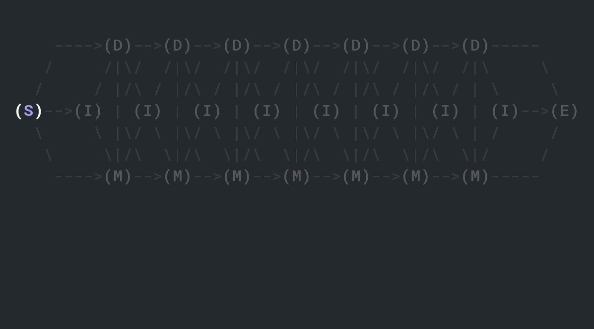

# Example gallery

These examples cover the main ways to use `anihmm`, from generated paths to
fully custom sequences. See the [Quickstart](quickstart.md) for setup or the
[Sequence builder](sequences.md) for custom-path rules.

## Random output

Set `emissions` to a number to show exactly that many random amino-acid symbols
while your code runs. Match and insertion states emit symbols; deletion states
do not.



??? example "Source: random_emissions.py"

    ```python
    --8<-- "examples/random_emissions.py"
    ```

## Fixed text

Set `emissions="LOADING"` to write a known message along the path while your
code runs. Your function behaves normally; `anihmm` only manages the terminal
display.


??? example "Source: fixed_text.py"

    ```python
    --8<-- "examples/fixed_text.py"
    ```

## Fixed text on changing paths

Use a reusable `frame_source()` when each loop should take a different route
through the HMM. The path changes, but the displayed message stays the same.


??? example "Source: changing_paths.py"

    ```python
    --8<-- "examples/changing_paths.py"
    ```

## Processing a block of work

Put synchronous work inside `processing_animation()` to keep the animation
running until the block exits. The work can return values as usual.



When the work finishes, the animation gives the terminal back cleanly—even if
it was midway through a path. You can then replace it with a final frame and
print the results.

??? example "Source: processing_demo.py"

    ```python
    --8<-- "examples/processing_demo.py"
    ```

## Progress driven by completed work

Call `advance()` whenever a unit of work finishes. Until then, the animation
scans the legal next states; afterward, it settles on your chosen state and
continues from there. After an insertion, its pointer flashes between the `D`
and `M` previews so the rhythm stays consistent.


Match and insertion states need a symbol; deletion states do not. This path
uses both emitting state types to spell `PROGRESS`, then `finish()` moves it to
`E`.

??? example "Source: progress_indicator.py"

    ```python
    --8<-- "examples/progress_indicator.py"
    ```

## Custom sequence

Use `HMMSequence` when you want to choose the exact path. Call `settle()` to
select a state and `emit()` to give a match or insertion its symbol. Once the
path is ready, `compile_steps()` turns it into playable frames.

This sequence spells `CUSTOM`, using explicit deletion states to spread the
letters across the model before moving to `E`.


??? example "Source: custom_sequence.py"

    ```python
    --8<-- "examples/custom_sequence.py"
    ```

## Automatic deletion completion

Call `finish()` on a partial bounded sequence and `anihmm` fills the unused
columns with deletion states before moving to `E`. You do not need to add those
final deletions yourself.


??? example "Source: delete_completion.py"

    ```python
    --8<-- "examples/delete_completion.py"
    ```

## Transition previews

Use `cycle()` to preview the legal next states, then call `settle()` to choose
one. Playback shows both the possibilities and the final choice.


??? example "Source: transition_previews.py"

    ```python
    --8<-- "examples/transition_previews.py"
    ```
